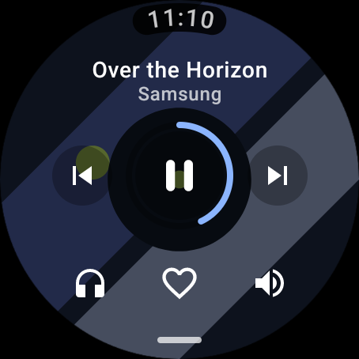
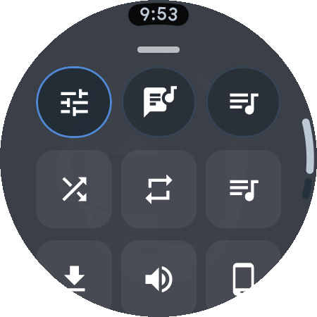
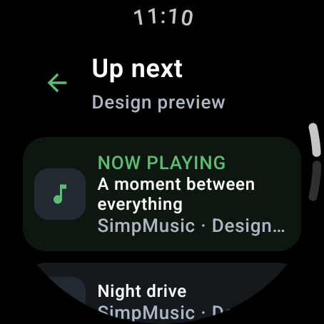
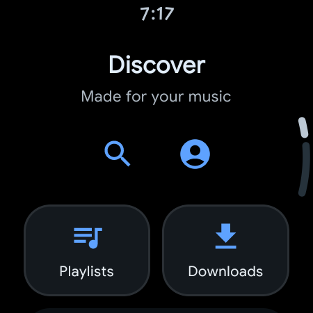
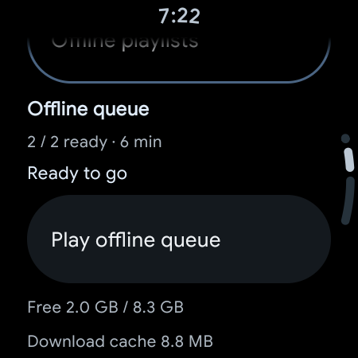
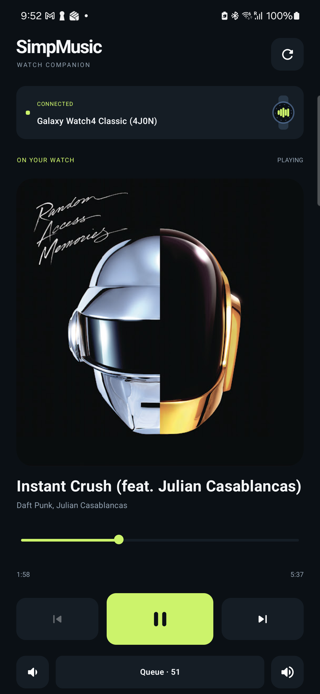
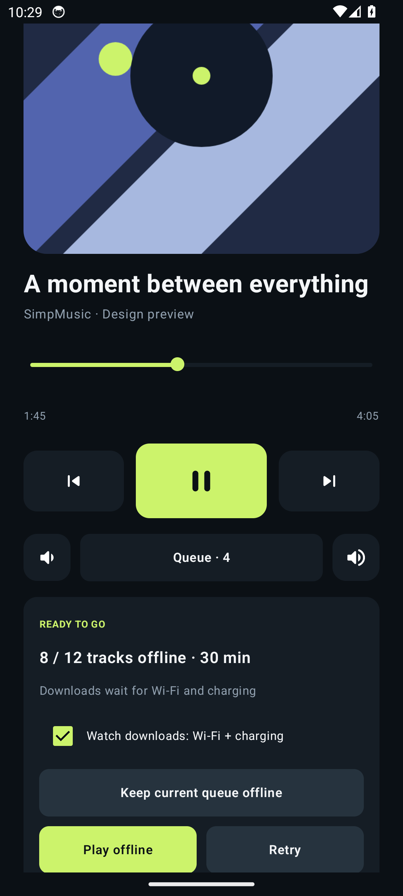
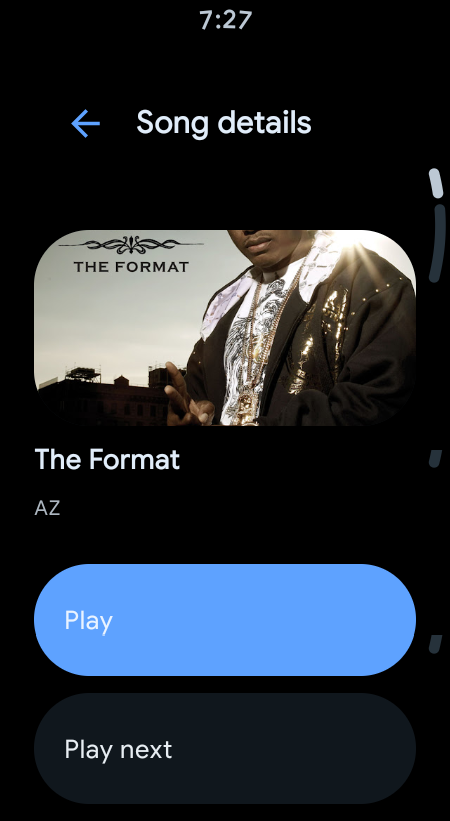
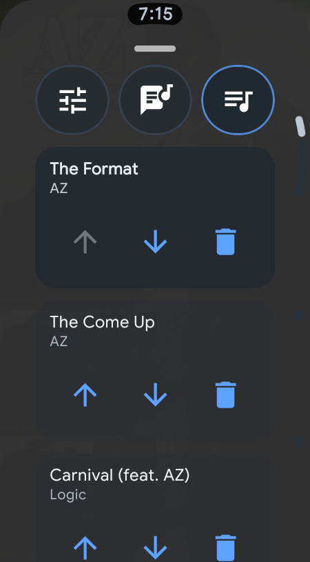

# SimpMusic-WearOS

SimpMusic for Wear OS. Browse and search YouTube Music, play directly on your watch, and download music to take with you.

The watch has its own player, queue, library and downloads. The Android companion handles signing in and gives you a bigger screen for controlling the watch. You can also build the full SimpMusic phone app if you want music playback on your phone too.

## On the watch

- Browse Discover, search for music, and open albums, artists and playlists.
- Access liked songs, recent plays, followed artists, podcasts and local playlists.
- An artwork-backed player with a circular progress ring, previous/next, like, audio output and volume controls. Hold play/pause to seek.
- Pull up the player drawer for controls, lyrics and the queue. Lyrics support translation and tapping a line to seek when timings are available.
- Download individual tracks or prepare a queue of up to 100 tracks for offline listening. The offline queue uses files verified to be fully downloaded on the watch.
- Keep playlists offline with automatic refresh, an estimated download budget and optional cleanup. Manage them from Downloads. [Offline playlist guide](docs/offline-playlists.md).
- Playback tile and complication, bezel volume control, and a battery saver option.

## Phone apps

There are two choices:

- **Companion:** the small phone app for signing in, sending the session to your watch, controlling watch playback, managing its queue and preparing an offline queue. It doesn't play music on the phone.
- **Full phone app:** SimpMusic's Android app with the watch bridge added. Use this if you also want phone playback, library sync and playback handoff.

Choose one on your phone. They use the same application ID, so installing one replaces the other. The watch and phone apps need matching application IDs and signing certificates for the connection to work.

This fork uses its own package name, `io.github.rahyan.simpmusicwear`, and can be installed alongside upstream SimpMusic. Debug builds add `.dev` and keep their own app data.

## Screenshots

| Player | Controls | Queue |
| --- | --- | --- |
|  |  |  |

| Discover | Offline music |
| --- | --- |
|  |  |

| Companion player | Offline queue |
| --- | --- |
|  |  |

<details>
<summary>Song details and more of the watch queue</summary>

| Song details | Queue |
| --- | --- |
|  |  |

</details>

Captured on a Galaxy Watch4 Classic and Galaxy S23. The two scrolling watch views use [WearCapture](https://github.com/Rahyan/WearCapture). [Capture details](asset/readme/current/README.md).

## Install and sign in

APK builds will be available on the [releases page](https://github.com/Rahyan/SimpMusic-WearOS/releases). Until then, use the source build instructions below.

Choose the watch APK for your watch's Android ABI and the companion APK from the same release. The ARM universal watch APK supports both ARMv7 and ARM64, with a larger download.

1. Install the watch APK on your watch, then either the companion or full app on your Android phone. Use a matching pair from the same build.
2. Open the phone app and sign in.
3. On the watch, open **Accounts → Sync session from phone**.
4. Pick something to play on the watch. The companion will show its player and queue.

You can browse and play as a guest too. Signing in is for your account and library.

For ADB install commands, isolated test builds and signing details, see [building and installing](docs/building.md).

If something breaks, [open an issue](https://github.com/Rahyan/SimpMusic-WearOS/issues/new/choose) with your watch model, Android version and app version. Please leave account cookies and tokens out of reports.

## Build it yourself

You need JDK 21, Android SDK 36, and the submodules. No Sentry account or release key is needed for a debug build.

```sh
git clone --recurse-submodules https://github.com/Rahyan/SimpMusic-WearOS.git
cd SimpMusic-WearOS
./gradlew --no-daemon :wearApp:assembleDebug :companionApp:assembleDebug
```

On Windows, use `gradlew.bat` instead of `./gradlew`.

The APKs are written to:

```text
wearApp/build/outputs/apk/debug/wearApp-debug.apk
companionApp/build/outputs/apk/debug/companionApp-debug.apk
```

The full phone app is optional: build it with `:app:assembleFossDebug`. More build, test and release commands are in [docs/building.md](docs/building.md).

## Compatibility

The companion requires Android 8.0 or newer. Watch builds are available for ARMv7 and ARM64. I've been testing this on my Galaxy Watch4 Classic, with a Galaxy S23 for the companion. If you're using another watch, let me know how it goes.

Playback and sign-in depend on YouTube's services and can break when YouTube changes them.

## About this fork

I'm building this fork to bring SimpMusic to Wear OS, with an Android companion for signing in and controlling the watch. It uses the Android codebase, with selected fixes adapted from upstream's multiplatform project. [Upstream notes](docs/upstream-compatibility.md) track those changes and the differences between the projects.

## Credits

Built on [SimpMusic](https://github.com/maxrave-dev/SimpMusic) by maxrave-dev and its contributors. The shared media and extraction code also relies on the projects credited upstream, including [NewPipe Extractor](https://github.com/TeamNewPipe/NewPipeExtractor) and [SmartTube](https://github.com/yuliskov/SmartTube).

This is an unofficial YouTube Music client. It isn't affiliated with Google or YouTube.

[GPL-3.0 license](LICENSE).
